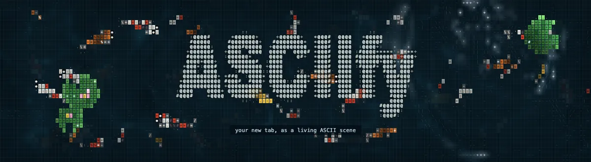
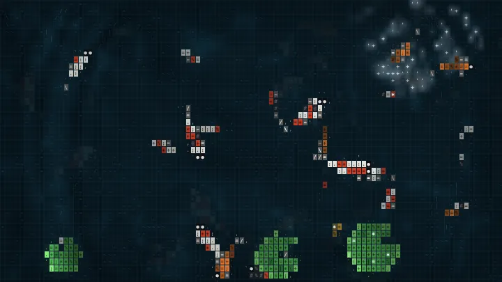
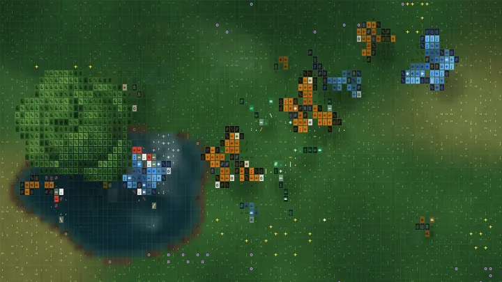
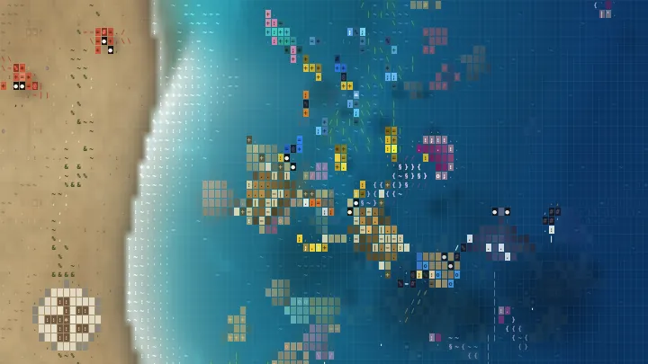
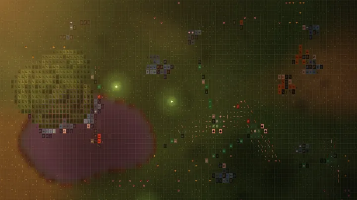
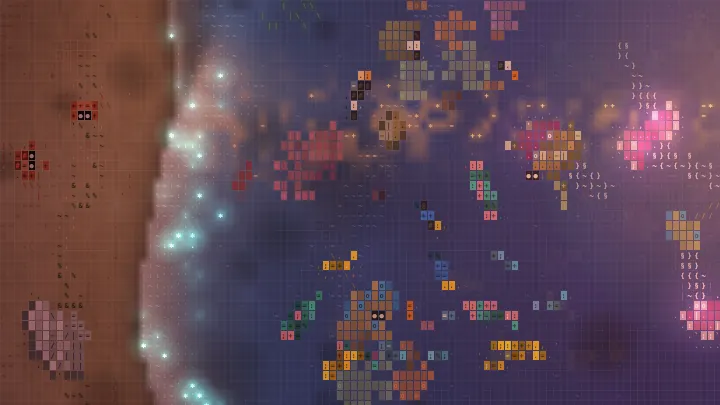

<p align="center">
  
</p>

<p align="center">
  <b>Your new tab, as a living ASCII scene.</b><br>
  Koi, butterflies, sea turtles and crabs, drawn live out of text characters, every frame.
</p>

<p align="center">
  
  
  
  
  
</p>

<p align="center">
  <a href="#scenes">Scenes</a> ·
  <a href="#install">Install</a> ·
  <a href="#settings">Settings</a> ·
  <a href="#how-it-works">How it works</a> ·
  <a href="#credits">Credits</a>
</p>

<br>

<table>
  <tr>
    <td width="33%"></td>
    <td width="33%"></td>
    <td width="33%"></td>
  </tr>
  <tr>
    <td align="center"><b>Koi pond</b><br><sub>ripples, lily pads, feeding koi</sub></td>
    <td align="center"><b>Meadow</b><br><sub>wind, butterflies, a pond and a tree</sub></td>
    <td align="center"><b>Beach</b><br><sub>waves, reef fish, turtles, crabs</sub></td>
  </tr>
</table>

ASCIIfy replaces Chrome's new tab page with an animated scene seen from above. Nothing in it
is pre-drawn: every animal is a shape that the renderer turns into colored blocks and
characters 30 times a second. Over the scene sit a big block-letter clock, a greeting, a search bar
and a settings panel. Move your mouse to stir the water or blow wind through the grass, and
click to feed the fish or startle the insects.

## Scenes

### 🐟 Koi pond


A dark pond where koi drift beneath rocking lily pads. The water is a real wave simulation,
so ripples spread, bounce off the edges, pass through each other and bend the fish seen
through them.

- Five koi varieties: kohaku, sanke, showa, ogon and chagoi. Fainter koi swim deeper.
- **Move the mouse** to drag a wake through the water. Faster moves make bigger waves.
- **Click** to drop food. It splashes, bobs on the waves, and nearby koi swim over to eat it.
- Moonlight glitters wherever the surface moves.

<br clear="right">

### 🦋 Meadow


A grassy field with patches of lush and dry grass, wildflowers, and gusts of wind that roll
across it in waves of light.

- Blue morphos and monarchs flutter, glide and land on flowers. Emerald dragonflies hover, then dart.
- A little pond with koi sits in the corner under a big tree that the insects fly beneath.
- **Your mouse is a wind stream.** It blows butterflies off course, rustles the tree and
  carries seed fluff and petals away, shown as pale wisps of air.
- **Click** the grass to puff it outward and startle everything nearby.

<br clear="right">

### 🐢 Beach


A narrow sandy beach beside a clear sea, with waves that break into foam and wash up the sand.

- Schools of tropical fish over a coral reef, clownfish at their anemones, pulsing
  jellyfish, sea turtles that rise to breathe, and stingrays gliding over the sea floor.
- Crabs scuttle along the sand and run from the waves, leaving footprints that wash away.
- Shells and starfish rock as the water washes over them.
- **Move the mouse** to ripple the sea, and flick it near a crab to send it running.

<br clear="right">

### 🌅 Sunset

The meadow and the beach each have a sunset setting: warm golden light, long shadows, and
things that glow in the dark. Fireflies blink across the meadow, while at the beach plankton
sparkle wherever the water churns and the jellyfish shine.

<table>
  <tr>
    <td width="50%"></td>
    <td width="50%"></td>
  </tr>
</table>

## Install

ASCIIfy isn't on the Chrome Web Store yet, so you load it in developer mode:

1. Download or clone this repository.
2. Open `chrome://extensions` in Chrome and switch on **Developer mode** (top right).
3. Click **Load unpacked** and choose the repository folder.
4. Open a new tab.

There's nothing to build or install. After editing a file, open a new tab to see the change.
If you edit `manifest.json`, click the reload icon on the extension's card first.

## Settings

Click **`[ settings ]`** in the corner of any new tab. Changes are saved and synced to every
computer you're signed into Chrome on.

| Setting | What it does |
| --- | --- |
| theme | Koi pond, meadow or beach |
| speed · animals | How fast everything moves, and how many creatures there are |
| lily pads · flowers · wave speed | Per-scene extras |
| sunset | Golden-hour lighting for the meadow or the beach |
| pond and tree | The meadow's corner pond |
| moonlight on the water | The koi pond's reflections |
| clock · search bar · name | The 12/24-hour clock, the search bar, and the name in the greeting |

## How it works

Each animal is a **shape**: a function that answers *"is this point inside me, and what color
is it?"* For every character cell near an animal, the renderer asks that question at five
points in the cell, a technique called supersampling. A mostly covered cell becomes a solid
block of color with a character on top, and a partly covered one becomes a faint character
at the edge. That's how text-mode animals get smooth outlines.

```
   shape            sampled cells            on screen
   .-""-.           . : # # : .            ·:██▓▓:·
  (      )   ──►    : # # # # :     ──►    :▓▓██▓▓:
   `-..-'           . : # # : .            ·:▓▓██:·
```

Underneath the animals, each scene paints a **ground**: a wave simulation for the water, wind
and bending blades for the grass, and a shoreline with breaking waves for the beach. A
fixed-timestep game loop works like a flipbook, stepping the world forward by exactly 1/30 s
at a time so animals move at the same speed on fast and slow computers.

```
src/
  engine/    renderer, flocking, water, grass, shore, sunset grading, game loop
  animals/   one file per species: koi, butterflies, dragonflies, crabs, turtles…
  scenes/    koi-pond, meadow, beach, and their props (reef, shells, tree)
  ui/        clock, search bar, settings panel
```

### Re-recording the previews

The animations in this README are recorded from the real scenes. After changing a scene, run
`node tools/readme-media/record.mjs` (it needs Chrome, and Python with Pillow) to record them
again into `docs/media/`.

## Credits

The renderer, flocking, koi, butterflies and dragonflies are adapted from
[ascii-animals](https://github.com/DesignerStephen1/ascii-animals) by drewdi and Stephen Zhang,
used under the MIT License (see [`licenses/ascii-animals-LICENSE.txt`](licenses/ascii-animals-LICENSE.txt)).
